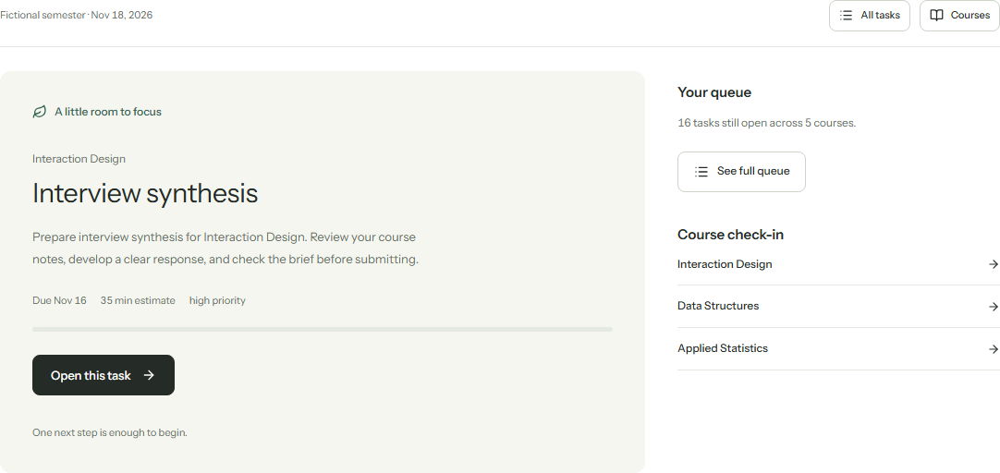
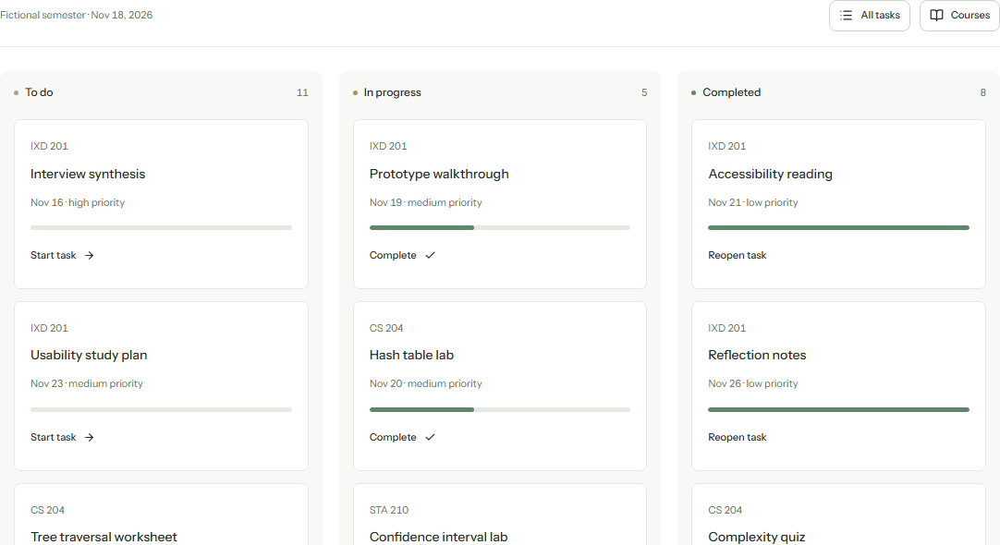
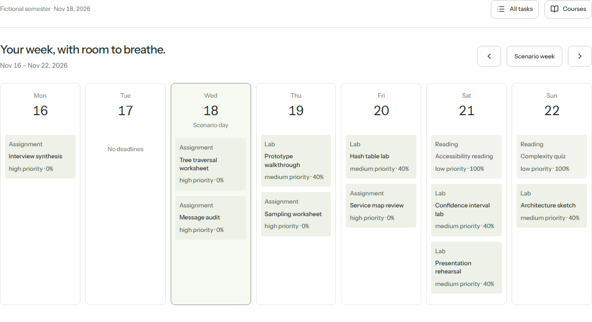
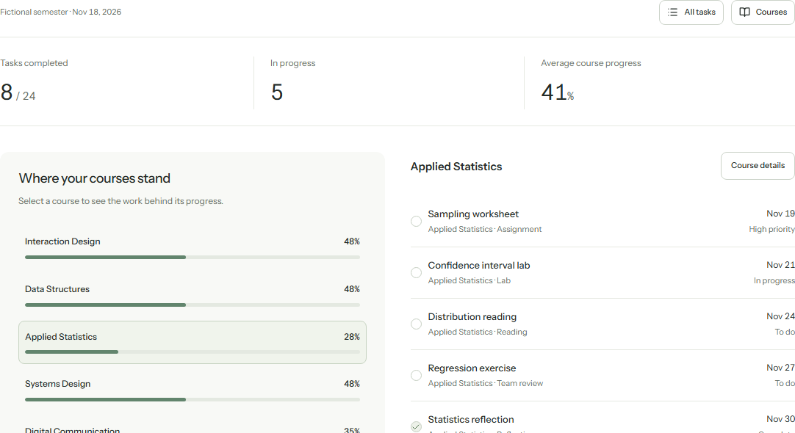
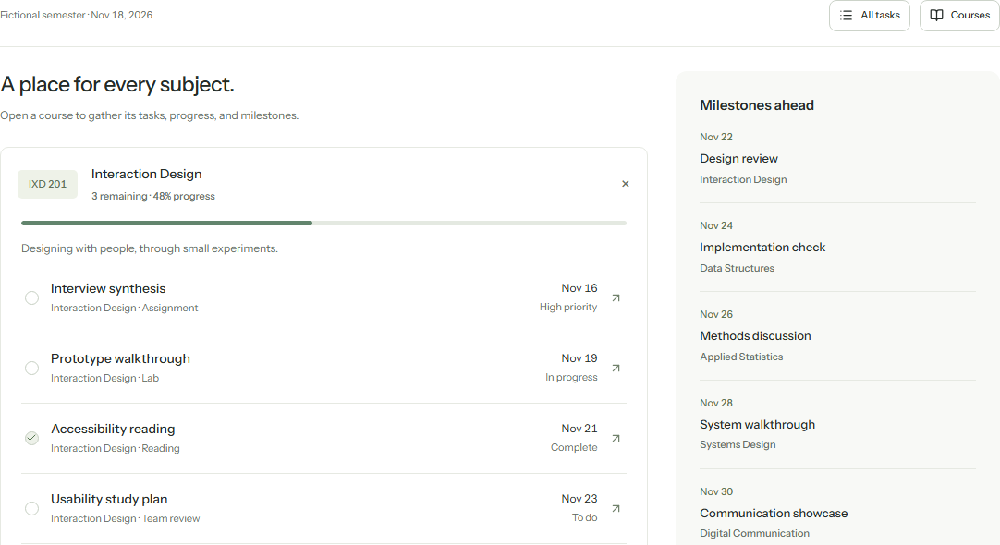
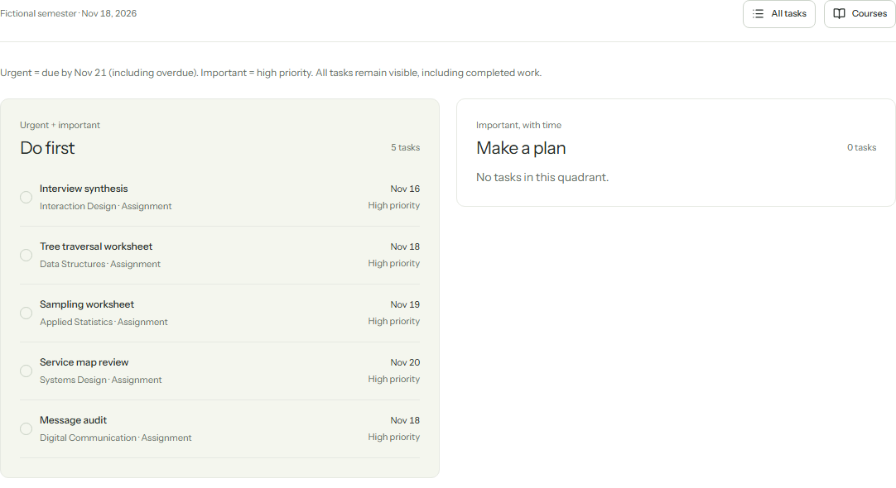
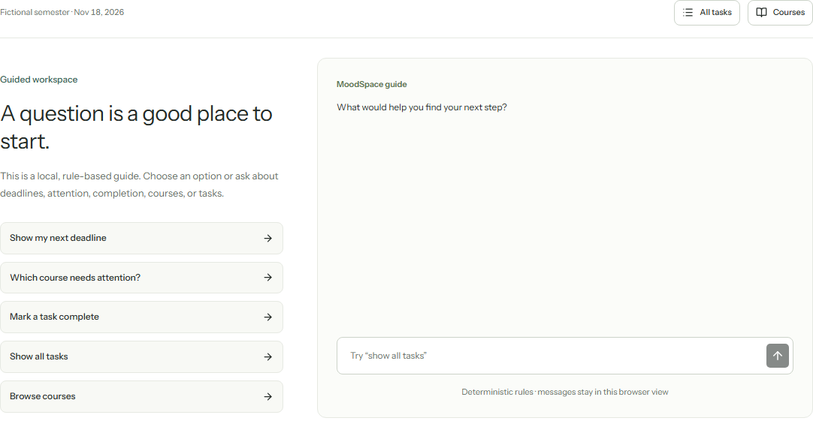
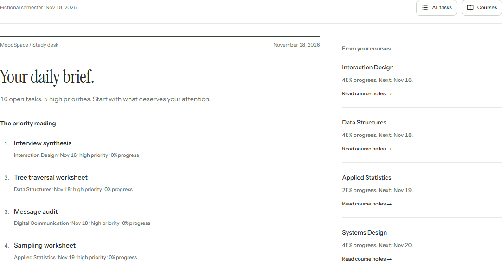

# MoodSpace

An original, local-first student workspace and undergraduate HCI research instrument. Eight genuinely different information structures work with the same five fictional courses, 24 tasks, eight milestones, and shared domain actions. All eight are available for positive, neutral, and stressed self-reported mood contexts. Study assignment is separate from the optional mood-guided design demo.

## Small-scale classroom demonstration

Exactly **3 mood classes and 8 total structures**; not 24 separate applications. Open `/adapt`, keep rehearsal provenance, leave the preferred layout empty, and opt into **mood-guided design suggestions**. Positive suggests Kanban Flow, Neutral suggests Daily Brief, and Stressed suggests Quiet Focus. These opt-in rules demonstrate visible adaptation and are explicitly not research findings. All eight remain selectable; your explicit preference and any sufficiently supported genuine empirical result take priority. The randomized study never uses these demo rules.

Optional consented text can now use a bundled, independently evaluated **public-corpus model** trained on Google Research GoEmotions. It predicts Positive/Neutral/a fear–nervousness proxy for Stressed; it does not measure a student's true emotional state. Held-out mapped-comment macro-F1 was 0.702 versus 0.300 for the majority baseline; balanced accuracy was 0.709 versus 0.333. See [the actual benchmark, licensing, sample counts and limitations](docs/public-data-experiment.md). Public data never contributes to real participant counts or mood–UI superiority. Self-report/correction remains authoritative. Python's standard library is enough for this optional runtime; when Python/model validation is unavailable, the labeled rule demonstration remains usable.

```powershell
npm run experiment:public       # Reproduce using the optional pinned Python environment
npm run experiment:public -- --offline  # Reuse verified local cache
```

Raw downloads stay in ignored `work/public-data/`. The repository includes only a numeric hashed-feature model, evaluation, license and attribution; no raw comments, author IDs, participant records or private `.env`. The original consented-study model has a separate validation gate and is not activated by this public experiment. Source/data alternatives reviewed are in [public-data-source-review.md](docs/public-data-source-review.md).

| U01 · Quiet Focus | U02 · Kanban Flow |
| --- | --- |
|  |  |
| **U03 · Weekly Planner** | **U04 · Progress Studio** |
|  |  |
| **U05 · Course Hub** | **U06 · Priority Matrix** |
|  |  |
| **U07 · Guided Assistant** | **U08 · Daily Brief** |
|  |  |

## Start on Windows / PowerShell

Use Node.js **24 LTS** (tested with 24.14.1), npm, and a folder outside OneDrive. The working checkout is `C:\Dev\moodspace-hci`.

```powershell
Set-Location C:\Dev\moodspace-hci
npm install
npm run dev
```

The existing working checkout already has an ignored `.env` with a randomly generated administrator password. **Do not overwrite that file to start this checkout.** Read/edit it locally if you need the research password; it is never bundled into the browser. The downloadable source archive omits this secret and all runtime data.

For a fresh source download, run `Copy-Item .env.example .env` and edit `ADMIN_PASSWORD` to your own long random password before starting the server. The example value deliberately cannot unlock the research console.

Open **http://127.0.0.1:5173**. Vite serves the frontend on 5173 and proxies `/api` to the Node server on 3001. Both bind to loopback by default. After installation the app uses no cloud, remote fonts, API keys, or Python. Stop with Ctrl+C.

```powershell
npm run build  # TypeScript check and production frontend build
npm start      # API + built frontend at http://127.0.0.1:3001
```

Node's built-in SQLite adapter emits its standard experimental-feature warning on Node 24. No native SQLite addon/compiler is required. This is a single-user-machine/local class instrument, not an Internet-hardened multi-tenant service.

## What works

| Route | Function |
| --- | --- |
| `/` | Overview, study explanation, runnable-workspace entry |
| `/gallery` | Eight original app-derived preview images, density filters, try links |
| `/workspace/U01`–`/workspace/U08` | Fully interactive demo workspace, manual layout and mood selection, reset fictional tasks |
| `/study` | Consent, before mood, randomized gallery, independent initial choice, practice, balanced assignment, eight timed scored trials, four feedback forms, final choice, after mood, debrief |
| `/results` | Post-study evidence readiness, user-choice fallback / empirical suggestion, acceptance and manual override |
| `/research` | Server-protected genuine-record dashboard, 24-cell coverage, performance, feedback, preference changes, session inspection/deletion, JSON and CSV ZIP exports |

U01 Quiet Focus is a spotlight/queue; U02 Kanban Flow has status lanes and working status buttons; U03 Weekly Planner has week navigation and a daily mobile agenda; U04 Progress Studio drills from progress bars to course work; U05 Course Hub expands subjects with tasks and milestones; U06 Priority Matrix groups urgent/important work; U07 Guided Assistant uses documented deterministic intents with fallback options; U08 Daily Brief is an editorial ranked digest. These have separate renderers in `src/variants/`.

Every layout exposes task details, due dates, priorities, course completion, milestones, and completion/status actions. Shared All tasks/Courses utilities guarantee feature parity. This common utility can reduce experimental differences if heavily used; the event log captures those navigation choices. Fixture dates are fixed to the explicitly labeled scenario day **2026-11-18**, so future calendar changes cannot alter scoring. Demo edits persist across layout/mood changes in the current browser view; reloading resets demo content. Study sandboxes persist on the server and reset for each trial.

## Run a session

Start at `/study`. Rehearsal mode is the default and is excluded from evidence. Choose genuine participant observation only after the course/institution review and recruitment arrangements are satisfied. No ethics approval is asserted by this software.

Save your private `session-id.token` code from **Session controls** to resume on another browser or delete all live records. The current browser stores only that credential in localStorage; authoritative workflow state is on the server. Do not share the code. A reload resumes an active task with elapsed wall time included. Stop for now records an active task as abandoned and saves the remaining place. Resume continues. Delete my data removes the participant and related live records atomically; researchers must also remove any previous exported copies.

The gallery order and allocation seed are persisted by the server. Initial preference does not choose assignment order. Within mood/provenance strata, four least-exposed designs are selected, seeded ties/order are randomized, and two matched task families (deadline lookup and completion action) rotate four distinct examples. Eight scored trials are not eight independent participants. Practice is unscored. Timed trials have a 90-second limit, explicit start, neutral response recording, and give-up/timeout/incorrect/abandoned outcomes. Scoring is verified against the server sandbox, not a participant's Done assertion.

Optional feeling text is processed by a phrase matcher in the browser only. Without explicit text-saving opt-in it is not sent or stored. Other optional comments/rationales are voluntary stored responses; avoid personal details. Mood is the person's own selection, with pleasantness and energy recorded separately.

## Data and exports

SQLite lives at `data/moodspace.sqlite` by default (configurable with `DATABASE_PATH`). The schema initializes at server startup; WAL and immediate transactions protect transitions. Nine indexed record tables contain API-validated JSON payloads. Events and workflow mutations carry idempotency IDs; retries cannot duplicate scoring or advance the workflow twice. A failed save shows Retry and blocks dependent saves until recovery. Research API access requires the server-side `.env` password even in development; an unset/example password disables access.

```powershell
npm run export      # Real records only: exports/<timestamp>/study.json, manifest, 11 CSVs
npm run reset:demo  # Deletes only source_type=demo participants; preserves real records
```

The research console also downloads JSON or one ZIP containing all CSV tables, manifest, and summary. CSV properly quotes values and neutralizes leading spreadsheet formulas. Empty CSV tables contain an ID header; full empty JSON schemas are documented in `docs/data-dictionary.md`. Token hashes and internal sandbox data are omitted from exports. Do not delete the whole database to reset demos. Automated tests use a separate `data/e2e.sqlite`; unit/API tests use isolated in-memory databases. Neither is used as real evidence. No human responses are auto-seeded.

## Recommendation and optional ML

With zero real participants the recommender returns `insufficient_evidence` and preserves the user's final preference. It never invents a mood-to-design mapping, accuracy, calibrated confidence, or study result.

Empirical mood mode requires at least **8 distinct real participants in each of all 8 compared mood/UI cells**. When that is sparse, a supported overall observed baseline may be used; otherwise user choice remains the fallback. The exploratory rule ranks participant-weighted success, then median task-family-normalized successful time, effort, and satisfaction. Practical ties preserve preference. Support and method/version are displayed, and the person can choose any UI. H3 (adaptation improvement over a fixed UI) stays unverified pending a held-out/prospective comparison.

`analysis/train_mood.py` implements optional TF-IDF + regularized logistic regression, participant-grouped cross-validation, majority baseline, macro-F1, balanced accuracy, and confusion matrix. It requires three classes and 15 distinct opted-in real participants per class; otherwise it writes `not_trainable` with reasons. Training artifacts remain local. Optional runtime inference is now supported only after a matching portable JSON model and valid grouped evaluation pass the deployment gate. Set MOOD_MODEL_DIR and MOOD_PYTHON as described in docs/model-deployment.md; missing/invalid/insufficient or baseline-failing artifacts retain self-report and a labeled rule demonstration. The basic app still requires no Python. Human-confirmed mood remains authoritative. The guide and immediate phrase matcher are rule-based, not LLMs. See `analysis/README.md` for optional setup.

## Verification

```powershell
npm test
npx playwright install chromium  # One-time browser download, outside OneDrive
npm run test:e2e
python -m unittest discover -s analysis -p "test_*.py" -v  # Optional Python checks
```

Playwright starts isolated API/Vite servers on 3011/4173 with explicit TEST_MODE and automated_test provenance. It uses a 20-second accelerated limit; production ignores TEST_TIMEOUT_MS unless TEST_MODE is true. Do not run real collection in TEST_MODE. The suite checks the entire participant session, all 24 mood/UI selections, actions, genuine-only research/export behavior, keyboard modal focus, and 1440/768/390px overflow. Test duration is a software verification metric, not a human usability duration. See `docs/verification.md` for actually executed results.

To regenerate original gallery images after layout changes, run the dev server and `node scripts/capture-previews.mjs`. Images are screenshots of this implementation; no reference-repository imagery is used.

## Architecture and remaining research work

`src/domain.ts` owns deterministic fixtures, canonical IDs, domain actions, rule-mood demonstration, and task scoring. `src/variants/` owns eight renderers; `Workspace.tsx` adapts shared details/actions/instrumentation. `App.tsx` supplies pages and restart-safe API integration. `server/app.ts` validates every API boundary, authenticates session/admin access, and controls workflow transitions. `server/db.ts` provides atomic SQLite storage; allocation, recommendation, and exports are separate modules. Vite proxies the local API during development; Express serves `dist` after a build.

The essential local application is implemented. Remaining work is human: 6–8-person usability/timeout rehearsal, course/institution approval and organizer contact/retention details, genuine recruitment, analysis of actual observations, and a prospective adaptation-versus-static study. Clustered bootstrap/confidence intervals, mixed/ordinal models, Internet hosting, and real-device/screen-reader certification are not implemented or claimed. No external recruitment or deployment was performed. See the methodology, decisions, variant comparison, references, data dictionary, and 6–8-minute presentation outline in `docs/`.

## Functional audit update (2026-11-19)

Open /adapt for direct assessment → all-eight candidate evaluation → explained preference/neutral fallback or supported empirical suggestion → saved acceptance/override → actual persistent workspace and voluntary follow-up ratings. /chosen-workspace provides the saved after-study workspace using the end check-in mood. These self-selected outcomes never rank experimental designs. The original randomized study remains at /study.

Research now includes mean/median successful time, failures/missingness, genuine mood/coverage charts, model evaluation when available, and recommendation acceptance/rejection/override rates. JSON/CSV exports remain genuine-only by default; use the explicit include checkbox or `npm run export -- --include-synthetic` to include clearly labeled test/rehearsal records. `npm run demo:coverage` exercises 48 synthetic sessions in memory and writes an explicit software-only coverage report under work/coverage-demo; it never opens the real database.

See docs/functional-audit.md, docs/instructor-demo-guide.md, docs/participant-testing-guide.md, docs/model-deployment.md and docs/audit-verification.md for current changes, operating instructions, executed results and data-dependent limits. No genuine classifier is configured with the present empty dataset.
